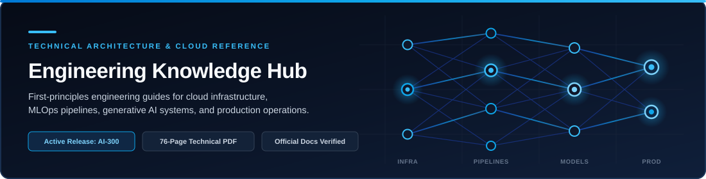

<div align="center">



<br><br>

[](microsoft/AI-300/README.md)
[](microsoft/AI-300/AI-300-Technical-Guide.pdf)
[](microsoft/AI-300/README.md#official-microsoft-references)
[](LICENSE)

</div>

---

## Overview

**Engineering Knowledge Hub** is a curated technical reference repository dedicated to deep, systems-level engineering documentation across cloud infrastructure, machine learning operations (**MLOps**), and generative AI operations (**GenAIOps**).

Every publication in this repository is built as a cohesive, first-principles engineering manual rather than a collection of scattered notes or superficial summaries—connecting architecture topologies, infrastructure-as-code definitions, identity and networking boundaries, code interpretation, and production troubleshooting into a single maintainable standard.

> **Current Release Scope:** This inaugural release publishes the **Microsoft AI-300 Technical Guide**. The repository layout is intentionally modular so additional technical publications can be added cleanly over time as they are completed and verified.

---

## Featured Publication — Microsoft AI-300

### Operationalizing Machine Learning and Generative AI Solutions on Azure

*Aligned with the **Microsoft Certified: Machine Learning Operations Engineer Associate (Exam AI-300)** certification blueprint.*

Designed for software engineering students, cloud engineers, and ML practitioners moving from local notebooks to automated, observable, and secure Azure AI systems, this **76-page technical reference** bridges classical MLOps (Azure Machine Learning) and modern GenAIOps (Microsoft Foundry) through first-principles architectural walkthroughs.

| Specification | Verified Details |
|---|---|
| **Document Format** | PDF 1.4 (`AI-300-Technical-Guide.pdf`) · 76 Pages · 105 Navigation Bookmarks |
| **Book Structure** | Front Matter · **6 Parts** · **21 Chapters** · **Appendix A** (Official Sources) |
| **Visual Architecture** | **10 Custom Vector Diagrams** covering VNets, Protocols, PyTorch DDP, Foundry & RAG |
| **Hands-On Depth** | Line-by-line Bicep, CLI v2, Python SDK v2, Prompt Flow YAML & `azure-ai-evaluation` labs |
| **Synthesis & Labs** | **7 End-to-End Production Blueprints** & **6 Code-Reading / Debugging Challenges** |
| **Reference Integrity** | Backed strictly by verified official **Microsoft Learn** & **MicrosoftLearning** GitHub docs |

<div align="center">

**[Download the Complete AI-300 Technical Guide (PDF)](microsoft/AI-300/AI-300-Technical-Guide.pdf)** &nbsp;&nbsp;|&nbsp;&nbsp; **[Explore the AI-300 Documentation Page](microsoft/AI-300/README.md)**

</div>

---

## Repository Structure

```text
engineering-knowledge-hub/
├── .github/
│   └── neural-hero.svg                      # Vector repository banner (GitHub-sanitized SVG)
├── LICENSE                                  # MIT License
├── README.md                                # Repository entry point & featured publications
└── microsoft/
    └── AI-300/
        ├── README.md                        # Complete AI-300 chapter index, diagrams & references
        └── AI-300-Technical-Guide.pdf       # Unmodified 76-page technical PDF guide
```

---

## Author, Maintenance & Independence Notice

Authored and maintained by **Yassine Drira**.

- **Independence & Exam-Policy Notice:** Unofficial community engineering guide. Neither affiliated with, sponsored by, nor endorsed by Microsoft Corporation. **Contains no exam questions, recalled exam items, or dumps**—all diagrams, blueprints, and debugging labs are original educational material.
- **Documentation Currency:** Content in the initial release reflects the official Microsoft Learn AI-300 study guide (published February 18, 2026) and verified Azure Machine Learning, Microsoft Foundry, Azure AI Search, and Azure OpenAI Service documentation.
- **Versioning:** Publications are maintained under explicit release notes inside their respective directories as Azure APIs and certification objectives evolve.

